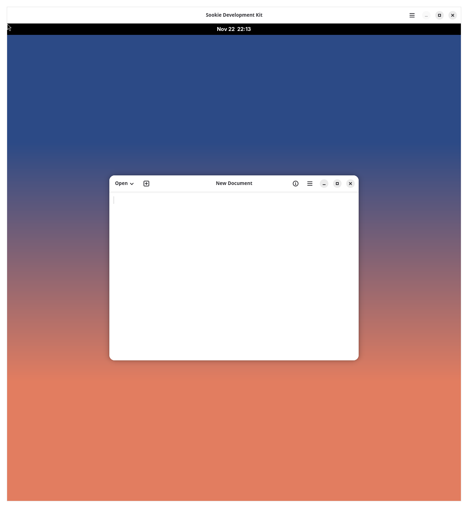

<div align="center">

# Cali

A desktop that feels like GNOME and lets you make it yours.

[](https://github.com/CaliDE-Foundation/DE/actions/workflows/build.yml)



</div>

## Build

```sh
git clone --recurse-submodules https://github.com/CaliDE-Foundation/DE
cd DE
make            # Zig, Rust and Go
make devkit     # run Cali in a window (podman)
```

Change settings with **Cali Settings** or `calictl set accent-color teal`; they apply right away.

Built on [Sookie](https://github.com/CaliDE-Foundation/Sookie). GPL-3.0-or-later.

### Experimental Layer Shell in Devkit

Once Sookie's development release (`nightly-dev`) has been published by
its build and test jobs, start an isolated Devkit from the CALI checkout:

```sh
make devkit SOOKIE_EXPERIMENTAL_LAYER_SHELL=1 CALI_APP=alacritty
```

In the nested terminal, run `wayland-info | grep zwlr_layer_shell`.
If the global is advertised, try `waybar`. This is experimental;
use a disposable session and do not enter sensitive credentials.
Plain `make devkit` continues to use the main-channel Sookie release.

### Experimental native Wayland decorations

Use the development Sookie build with negotiated SSD, not the visual preview:

```sh
make devkit SOOKIE_EXPERIMENTAL_SSD=1 CALI_APP=alacritty
```

Inside the nested session, run `scripts/test-ssd.sh`. It opens an isolated
Alacritty test window and checks the actual decoration configure event in the
Wayland trace when that window closes. Mode 2 confirms server-side negotiation;
mode 1 indicates client-side decorations. Verify titlebar count, movement,
resize edges, minimize/restore, maximize/restore and closing manually. The
script does not claim visual or input conformance. The temporary trace is
removed on exit; avoid entering sensitive information in the test session.
